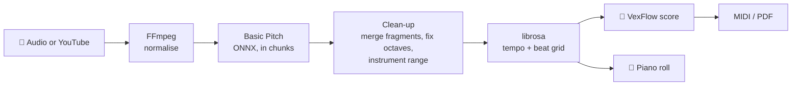

<div align="center">

# 🎹 AI Score Transcriber

**Drop in a song. Get the sheet music.**

Audio → MIDI → a readable piano score you can edit, play back and export.

[**▶ Try it live**](https://piano.simplyonegoal.com) &nbsp;·&nbsp; [How it works](#how-it-works) &nbsp;·&nbsp; [Run it yourself](#run-it-yourself)


</div>

---

Finding the score for *that one piece* is often impossible. This app listens to any recording — piano, guitar, a voice, a full band — and writes down the notes for you, so you can practise from a score instead of by ear.

It runs on Spotify's open-source [Basic Pitch](https://github.com/spotify/basic-pitch) model (ONNX, no TensorFlow), plus a lot of clean-up so the result reads like music and not like noise.

## What you get

- 🎧 **Any input** — upload WAV / MP3 / FLAC / OGG / M4A / WEBM (up to 50 MB), paste a YouTube link, or try the bundled sample.
- 🌊 **Piano roll** — notes fall onto a playable keyboard, in time with the original audio.
- 🎼 **Real sheet music** — rendered with VexFlow, with the key signature detected for you.
- ✏️ **Edit the score** — drag a note to change pitch, set lengths, add or delete notes, undo/redo. Every edit flows into the exports.
- 🔊 **Hear it** — a piano synthesised in the browser plays *the transcription itself*, next to the original recording (mute either one).
- 🐢 **Practise slowly** — change playback speed without re-barring the score.
- 💾 **Export** — MIDI (with your edits), the score as PDF, or the audio.

## How it works



- Transcription runs **in the background**: the page gets a job id right away and shows real progress while long files are processed in overlapping chunks (memory stays flat).
- **Detail level** (clean / balanced / detailed) and the **instrument range** cut out most false notes.
- Results expire after one hour — nothing is kept.

## Run it yourself

Requires **Python 3.10+**.

```bash
git clone https://github.com/Villamediana/AI-Score-Transcriber
cd AI-Score-Transcriber
python3 -m venv venv && source venv/bin/activate   # Windows: venv\Scripts\activate
pip install -r requirements.txt
python app.py
```

Open **http://127.0.0.1:5000**, drop a file, hit **Transcribe**.

<details>
<summary><b>Enabling the YouTube tab</b></summary>

<br>

YouTube usually blocks downloads without a logged-in session, so the YouTube tab only shows up when the app has a cookies file.

1. Export your YouTube cookies in **Netscape format** — e.g. with the [Get cookies.txt LOCALLY](https://chrome.google.com/webstore/detail/get-cookiestxt-locally/cclelndahbckbenkjhflpdbgdldlbecc) extension (a secondary account is a good idea), or:
   ```bash
   yt-dlp --cookies-from-browser chrome --cookies cookies.txt "https://www.youtube.com"
   ```
2. Point the app at it before starting:
   ```bash
   export YOUTUBE_COOKIES_FILE="$HOME/AI-Score-Transcriber/cookies.txt"
   ```
3. For yt-dlp 2025.11+, install [Deno](https://deno.land) and keep `~/.deno/bin` on your `PATH` — the app already enables the EJS component.

`cookies.txt` is git-ignored. Never commit or share it. Cookies expire; export a fresh file when YouTube starts blocking again.

</details>

<details>
<summary><b>On a phone or tablet</b></summary>

<br>

- Tap **Upload File** and pick the audio from *Files* or *Downloads*.
- "Network error" usually means the file is over 50 MB or the connection timed out — try a shorter track or Wi-Fi.

</details>

## Under the hood

```
app.py                      Flask routes, job endpoints, audio conversion
jobs.py                     background queue: progress, cancel, expiry
transcribe/
  basic_pitch_module.py     Basic Pitch (cached ONNX), chunking, tempo grid, clean-up
static/js/
  synth.js                  piano voice + look-ahead scheduler on the audio clock
  sheet.js                  score model, rhythm grid, key detection, VexFlow
  app.js                    UI, job polling, piano roll, editor, transport, export
templates/index.html
```

| Job | Library |
|---|---|
| Notes from audio | `basic-pitch` (ONNX) |
| Tempo & beats | `librosa` |
| MIDI | `pretty_midi` |
| Audio conversion | `imageio-ffmpeg` |
| Score in the browser | VexFlow · Tone.js MIDI · jsPDF |
| Piano sound | Web Audio, synthesised — no samples to download |

---

<div align="center">
<sub>Made by <a href="https://github.com/Villamediana">Miguel Villamediana</a> · works with any instrument, sounds best with piano 🎹</sub>
</div>
